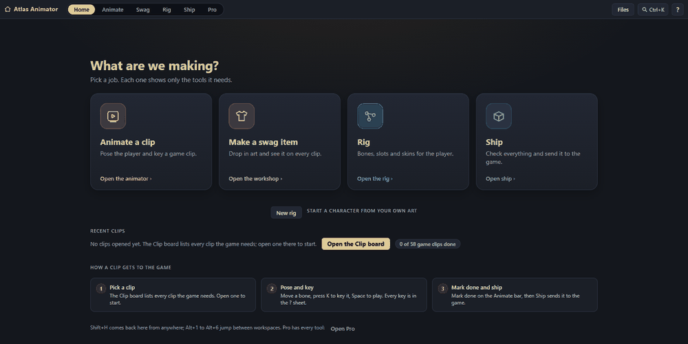
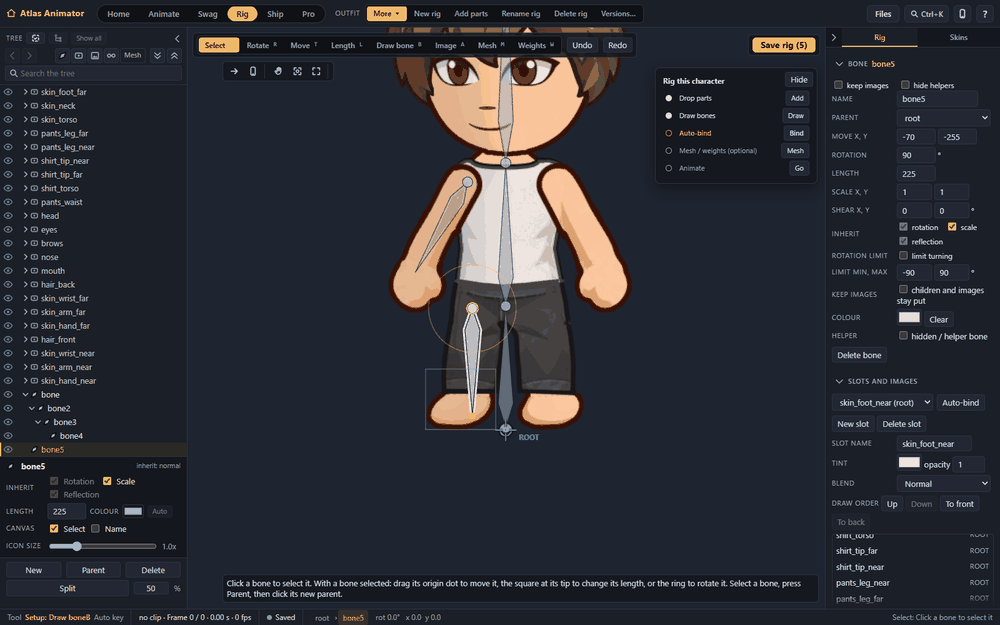

# Atlas Animator

Atlas Animator is a 2D skeletal animation editor that runs in your browser. Import your art (PNG layers or a PSD), draw bones,
bind the art to them, pose and key animations on a timeline, and export the result as JSON that Spine-compatible runtimes can read.
It includes a mesh and weight editor, inverse kinematics, easing curves, events, onion skinning, clothing/item pieces that follow the
rig, and a small PixiJS runtime (`@atlas-animator/core`) for playing the rigs back.





## Requirements

- Node.js 24
- pnpm 11 (`corepack enable` is enough if you have a recent Node)
- A current desktop browser (Chrome, Edge, Firefox, Safari) with a window of about 1600 x 1000 or larger
- Optional: Python 3 with numpy, Pillow and scipy, only for the seam-ink polish tool (`packages/animator/scripts/polish-seam-ink.py`); its test is skipped without them

Works on Windows, macOS and Linux.

## Quick start

```sh
git clone https://github.com/TonyTorzido/atlas-animator.git
cd atlas-animator
pnpm install
pnpm dev
```

Open <http://127.0.0.1:5211/>. The editor starts with a bundled sample character so you can play right away.
`pnpm dev:sandbox` does the same but keeps all data in a throwaway folder inside the checkout.
On Windows you can also double-click `tools/atlas-animator/Start Atlas Animator.cmd`; it runs the editor in the background from wherever you cloned the repository.

## Your first rig

1. **New rig.** On the Home screen press **New rig**. Name it, choose **Blank** as the starting point, and drop in your art: separate PNGs (one per body part) or a layered PSD.
   The editor packs an atlas and puts each part in its own slot.
2. **Draw bones.** In the **Rig** workspace pick the Bone tool and click-drag from the root outward: spine, head, arms, legs. Name bones by dragging in the bone list.
3. **Auto-bind.** Select a part and press **Auto-bind** (or build a mesh and use **Auto weights**) so the art follows the bones when they rotate. Check the result with the weight view.
4. **Key a pose.** Open **Animate**, press **New** to make a clip, move to a frame, rotate a bone, and press `K` to key it. Add a second pose a few frames later and press `Space` to play. Loop it, then adjust easing in the curve view.
5. **Export.** Open **Ship**. **Export Spine** writes a JSON skeleton and atlas, **Download** saves the rig or clip files.

The full walkthrough, with a screenshot per step, is in [docs/USER-GUIDE.md](docs/USER-GUIDE.md); the editor also opens it from **Help > User guide**.
The **Clip board** (Animate workspace) is a sample checklist of clips for a humanoid action character. It is optional: ignore it and make your own clips with **New clip**,
or add your own required clips with **Add slot**.

## Where data is stored

Everything you make lives in one folder outside the repository, so updating or deleting the checkout never touches it:

| System | Default data folder |
| --- | --- |
| Windows | `%USERPROFILE%\Documents\Atlas Animator\` |
| macOS and Linux | `~/Documents/Atlas Animator/` |

It holds your rigs, clips, poses, autosaves, history, exports and backups. Change it in the editor under **Files > Data folder**, or start with
`pnpm dev --data-dir <absolute folder>` (or the `ATLAS_EDITOR_DATA_DIR` environment variable). The rigs in `packages/animator/rigs` are bundled samples; the
first time you edit one, the editor copies it into your data folder and changes only your copy.

**Publish to project folder** (Ship workspace) copies a rig or clip from your data folder into a project folder, for example your game's asset folder. It is off
until you choose that folder: `pnpm dev --publish-dir <absolute folder>` or `ATLAS_EDITOR_PUBLISH_DIR`. It never runs git.

## Exporting

**Export Spine** writes a JSON skeleton (bones, slots, skins, meshes, weights, IK, animations, events) plus the atlas that Spine-compatible runtimes can load.
Spine is a trademark of Esoteric Software LLC. Atlas Animator is an independent project and is not affiliated with, endorsed by, or sponsored by Esoteric Software;
it contains no Spine code and has no Spine dependency.

For playback in your own app there is a small PixiJS runtime in `packages/animator` (`@atlas-animator/core`, import from `@atlas-animator/core/pixi`).

## Project layout

| Path | What it is |
| --- | --- |
| `packages/animator` | `@atlas-animator/core`: rig format, skeleton and animation runtime, PixiJS renderer, editing commands, auto-mesh and auto-weights, CLI tools, sample rigs and fixtures |
| `packages/animator-editor` | `@atlas-animator/editor`: the browser editor (Vite dev server with a small local API for saving files) |
| `docs` | User guide, editor reference and screenshots |
| `tools/atlas-animator` | Windows launcher (`.cmd` / `.ps1`) that runs the editor detached |

Commands from the repository root:

| Command | Does |
| --- | --- |
| `pnpm dev` | Run the editor (`--sandbox`, `--port`, `--data-dir`, `--publish-dir` are accepted after `--`) |
| `pnpm build` | Production build of the editor |
| `pnpm typecheck` | TypeScript checks for both packages |
| `pnpm test` | Unit tests for both packages |
| `pnpm verify` | Type-check, tests and the browser QA suites (`pnpm verify --fast` skips the browser suites; the browser suites need Playwright Chromium) |

## Contributing

Issues and pull requests are welcome. Please run `pnpm typecheck` and `pnpm test` before opening a pull request, and keep changes focused.
New behaviour needs a test next to the code it changes.

## Licenses

- Source code: MIT, see [LICENSE](LICENSE).
- Rig art, images and documentation: CC BY 4.0, attributed "Atlas Animator by TonyTorzido", see [LICENSE-ASSETS.md](LICENSE-ASSETS.md).
