# Atlas Animator: user guide

This guide walks through the editor screen by screen. In the editor, open this guide from **Help** (top right) > **User guide**.

## 1. Getting started

**Start it.** On any system run `pnpm dev` in the repository folder and open `http://127.0.0.1:5211/`. On Windows you can instead double-click `tools\atlas-animator\Start Atlas Animator.cmd`: it starts the editor in the background (it keeps running after the window closes) and opens your browser. Running it again while the editor is already up only opens the browser; it never restarts anything. If it does not open, see section 5.

**Stop it.** Normally leave it running. To stop it, run `powershell -File "tools\atlas-animator\start-atlas-animator.ps1" -Stop`. That stops only the editor.

**Use a big window** (1600 x 1000 or more).

**The six workspaces** (top bar; the last one you used is remembered):

| Workspace | Use it for |
| --- | --- |
| Home | Start here: make a new rig, open the Clip board |
| Animate | Pose and key clips |
| Swag | Clothing and item pieces on the rig |
| Rig | Setup mode: bones, images, meshes, weights, skins |
| Ship | Check everything and send it to your project |
| Pro | Every tool at once (the full layout) |

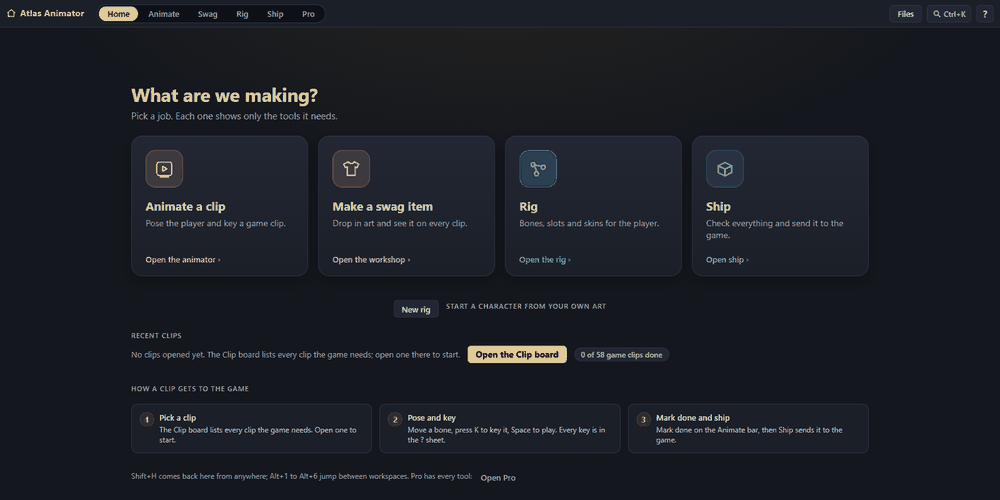

**Save state** is in the status bar at the bottom: Saved, Unsaved, Autosaving. Click Unsaved to save. `Ctrl+S` saves. `Ctrl+Z` / `Ctrl+Y` undo and redo. Hover any button for its description and hotkey.

**Help** (top right, next to Files) opens a menu: **User guide**, **Keyboard shortcuts**, **Troubleshooting**, **Open data folder path** (copies the path) and **About** (version and commit). The `?` key or `F1` opens the shortcut sheet directly.

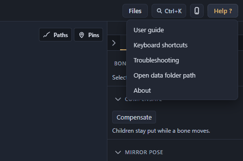

## 2. The five workflows

### A. Make a new rig

1. On Home press **New rig** (the Rig workspace has a **New rig** button too).
2. Type a **Name** (the folder id follows it), pick a **Starting point** (**Blank**: only a root bone; **Player skeleton**: the sample player's bones and IK, no art), and drop your parts: several PNGs, or one layered PSD (one layer per body part). The practice kit is `kit-body-cutout_layers.psd`: 23 layers are listed, placed where they were drawn, with the root on the ground.
3. Press **Create rig**.

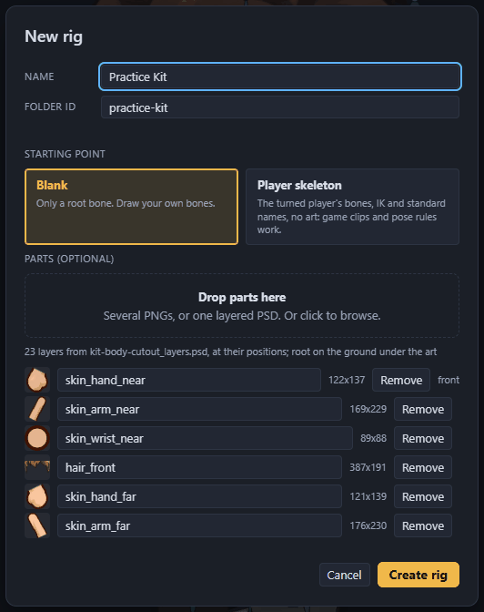

The editor creates the rig document, packs the atlas, puts every part in its own slot on the root bone and opens the Rig workspace. A **Rig this character** card lists what is left: **Drop parts** (Add), **Draw bones** (Draw), **Auto-bind** (Bind), **Mesh / weights (optional)** (Mesh) and **Animate** (Go). Nothing is bound to bones yet: do that in section B. Nothing is in your project yet either; a new rig exists only in your data folder (section 3) until you publish it (section E).

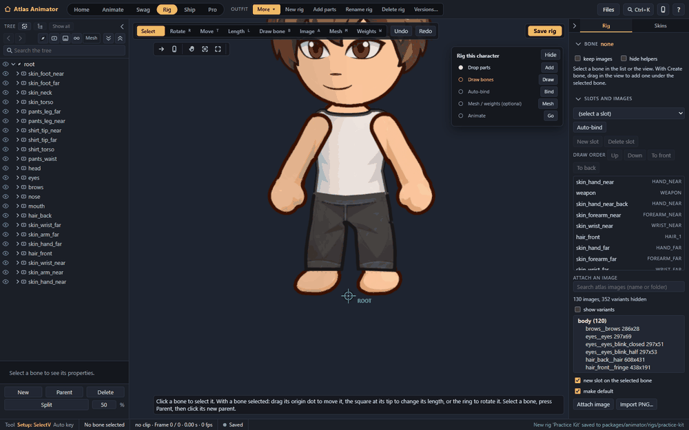

### B. Rig it (bones, auto-bind, mesh, weights, IK)

1. In **Rig** the tool bar has **Select** (V), **Rotate** (R), **Move** (T), **Length** (L), **Draw bone** (B), **Image** (A), **Mesh** (M) and **Weights** (W), plus **Undo**, **Redo** and **Save rig**.
2. Choose **Draw bone** and drag in the view from where the bone starts to where it ends. The new bone's parent is the bone you press on, or the selected one; each new bone is selected, so dragging again continues the chain. To branch, select a bone first. Drag a bone to rotate it, the origin dot to move it, the tip square to change its length.

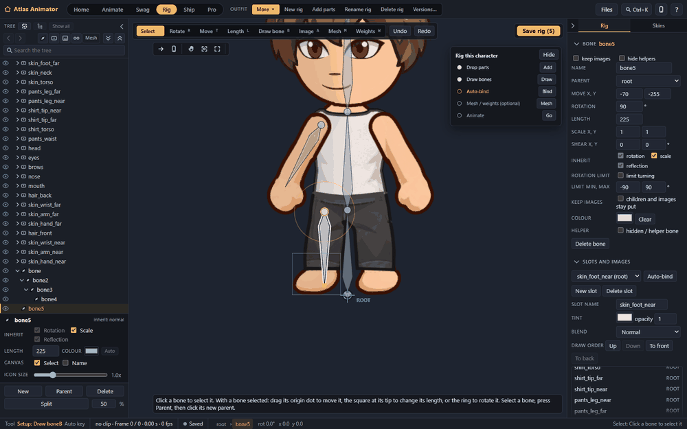

3. Press **Auto-bind** (Rig tab, or **Bind** on the steps card). Every slot moves to its nearest bone; the status bar says how many. Check each part and use the slot's bone selector to fix any that landed on the wrong bone.

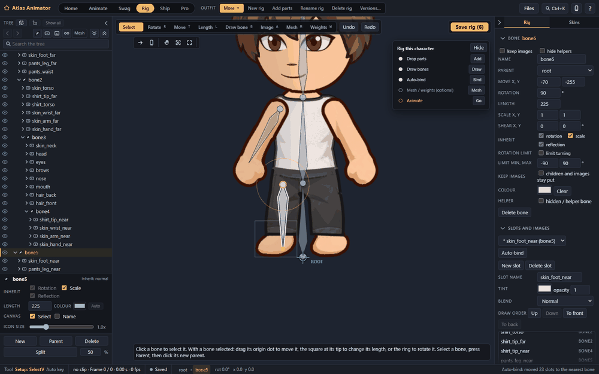

4. **Save rig**. The button shows how many edits are waiting; setup edits go through the command log, so Undo works here, and the editor refuses to save over a rig that changed on disk (it says so; reload the page and redo the last edit).
5. Mesh: select a part in the tree, choose the **Mesh** tool, then **Fill grid** (or **Trace picture**, or **Keep rectangle**). **Points** / **Lines** / **Outline** and **Select** / **Add** / **Delete** edit the points by hand; the Check section shows the minimum angle and coverage.

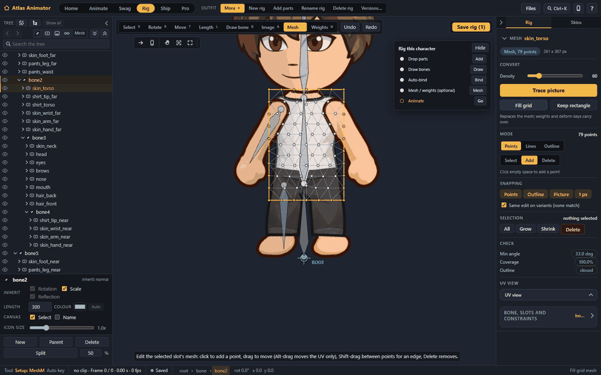

6. Weights: a part needs a mesh first (the Weights panel says "This rig has no mesh. Use Mesh to convert an image first"). Choose the **Weights** tool. Under **Bind and auto-weight** pick **Heat** or **Distance** (or **Sleeve profile**) and press **Apply** for a good first pass, then fix it with the **Paint** brush (**Add**, **Subtract**, **Smooth**, **Set**), and **Normalise**.

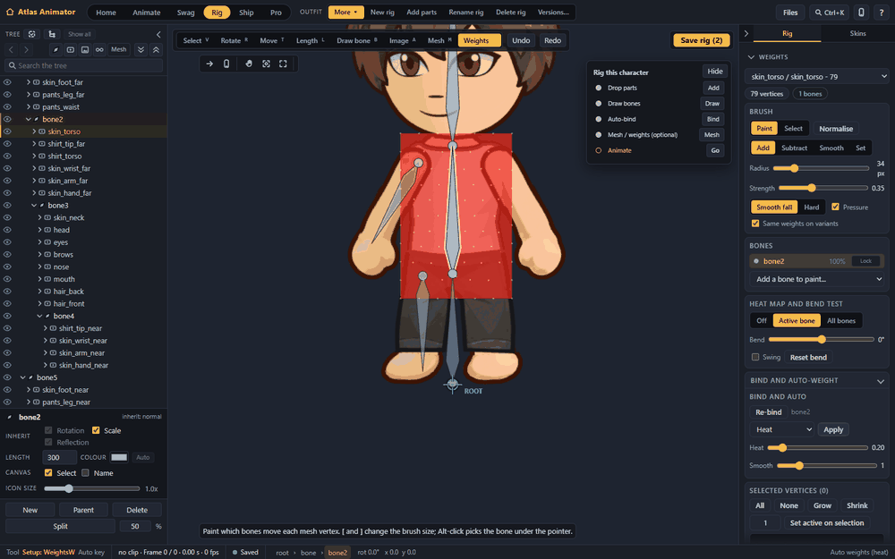

7. IK: select the end bone of a limb and press **2-bone IK** (or **1-bone IK**) under **Constraints** in the Rig tab. The editor makes the IK constraint and a target bone (for example `bone4_ik`, target `bone4_target`). **Transform** adds a transform constraint.

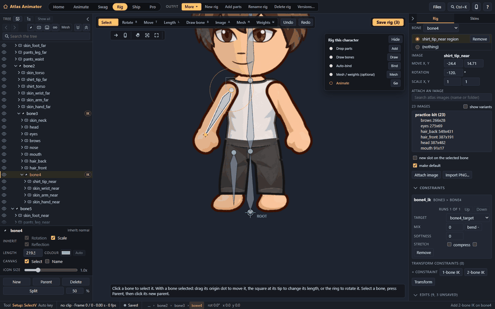

8. Skins: the **Skins** tab holds the different outfits (for example `chest.leather`).
9. **Export Spine** (Ship, or the Pro Export tab) and **Import from Spine** (Pro, Export tab only) move the whole rig to and from the Spine editor. After **Import from Spine** there is a **Revert import** button.
10. **Versions…** (Rig header) lists the saved versions of the rig document; **Restore** brings one back (the page reloads).

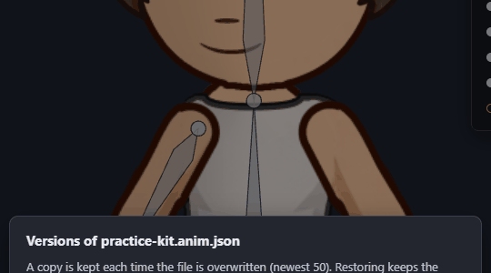

### C. Animate (clips)

1. Open **Animate**, then press **Clips** (header): the **Clip board** lists a sample set of clips (per weapon and class; optional) with a status. Pick one, or press **New** in the header, type a name and **Create** for an empty 1 second clip.

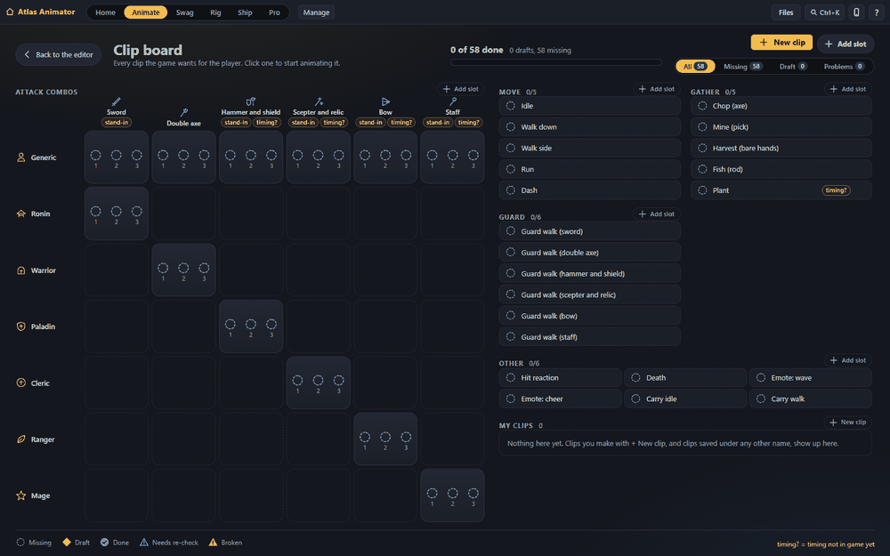

2. Scrub the timeline (click it, **Frame ▶** / **◀ Frame** for single frames, `Home` / `End`). Rotate a bone to pose it. With **Auto key** on, the pose is keyed when you release; **Key character pose** keys every standard pose bone, **Key selected bones** (`K`) keys each selected bone's changed channels (rotate, move, scale, shear; rotate when nothing changed), **Key all channels** keys all four channels of the one active bone, **Delete key** removes keys at the playhead. An unkeyed pose is not lost when you scrub, play or switch clips: it stays parked on its frame (come back to it to key it, or use **Discard unkeyed**).
3. Play with **Play** (`Space`). **Snap to frames** shows the clip as the runtime draws it (whole frames). Set **Loop** and **Length** (seconds, with the frame count beside it).

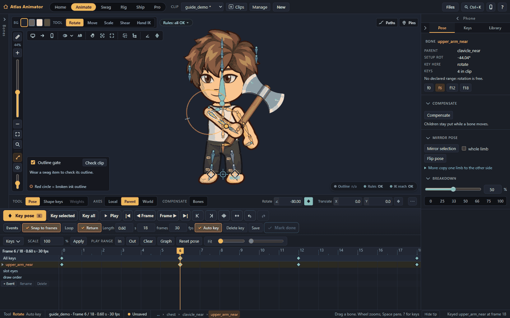

4. Easing: select a bone with a key at the playhead, open the **Keys** tab. **Curve (this key to the next)** has **Linear**, **Stepped**, **Ease in**, **Ease out**, **In-out** and **Bezier**, and **Presets** such as **Anticipation hold**, **Fast strike**, **Overshoot, settle** and **Damped settle**.

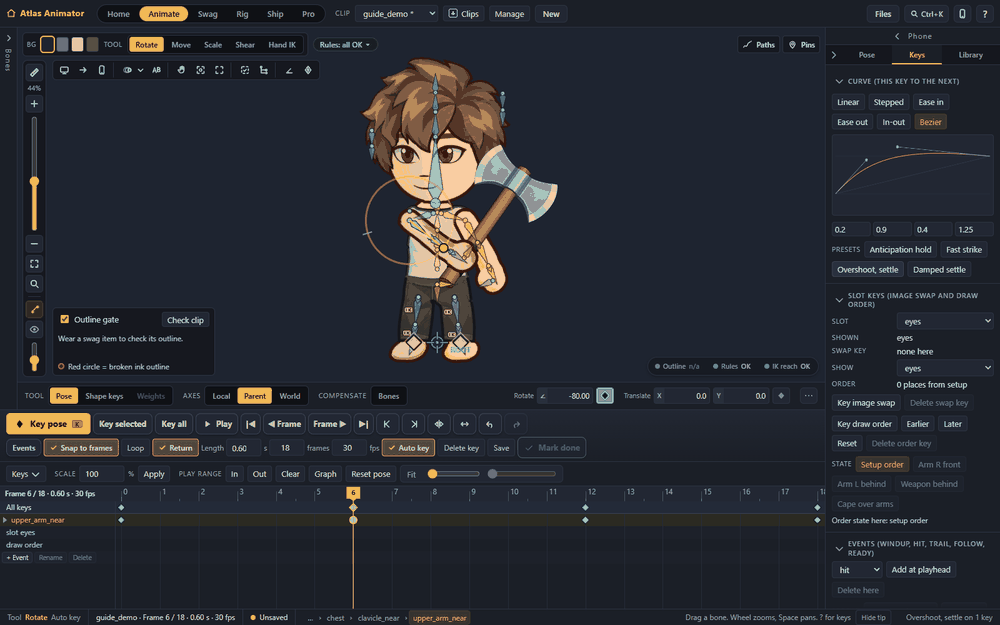

5. Events (windup, hit, trailOn, trailOff, follow, ready) tell your runtime when things happen. In the Keys tab, **Events** section: pick the type, then **Add at playhead** (**Delete here** removes it). The marker shows on the timeline; **+ Event** on the timeline's left edge adds one too.

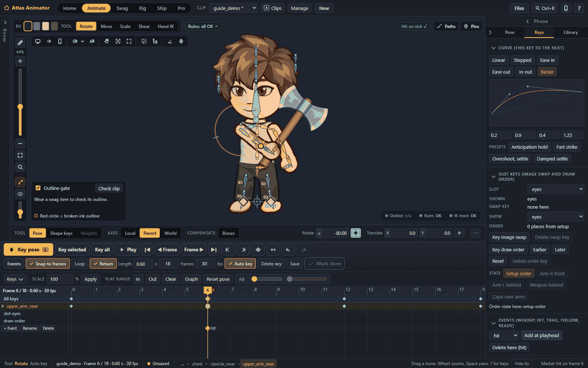

6. Onion skin: **Onion skin** (view toolbar, `Alt+O`) shows the frames before (cool) and after (warm); **Onion settings** sets how many, the step, the style (**Tint** / **Outline**) and the opacity.

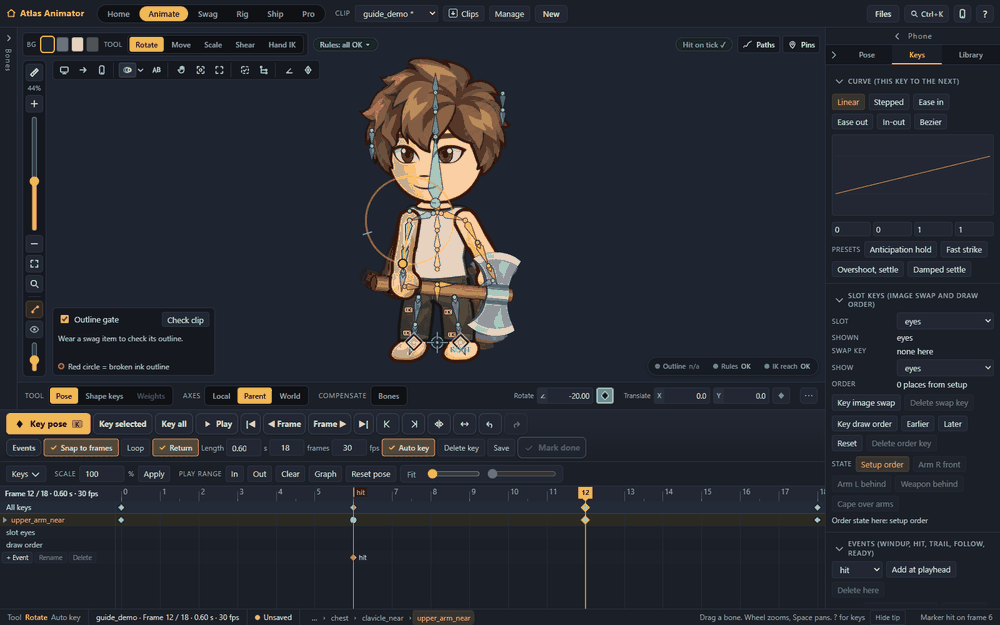

7. Compare two poses (A / B): **Compare poses A / B** (view toolbar, `Q`) pins the current pose as A; move the playhead and the pose is ghosted against it. The same controls (**Pin A**, **Ghost A**, **Swap A / B**, **Clear**) are in the Preview tab.

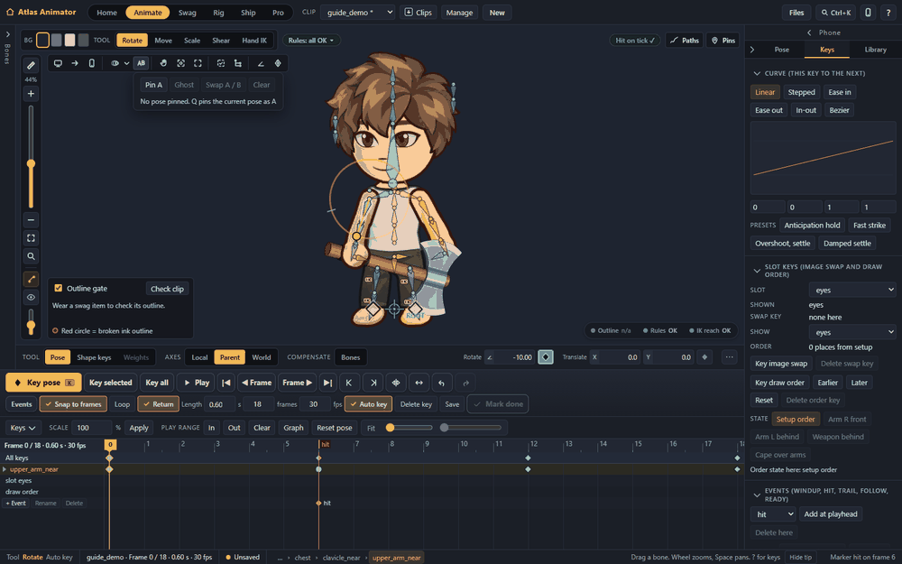

8. **Save** (`Ctrl+S`) writes `<name>.clip.json` into the `clips` folder of your data folder. Do this often. Autosave also keeps versions in the background; they are in the **Library** tab under **History**: **Preview** shows a version without changing anything, **Restore** brings it back as one undo step. If you reopen the editor with unsaved work newer than the saved file, a bar offers **Restore**, **History** or **Dismiss**.

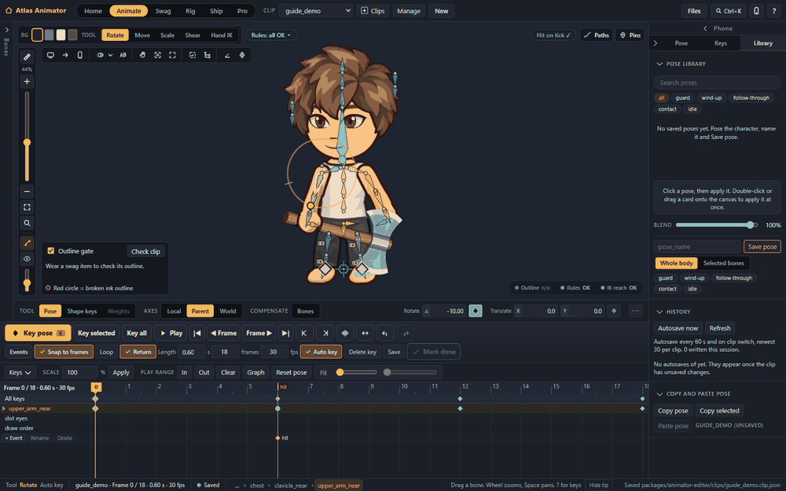

9. Press **Mark done** on the Animate bar once the clip passes the checks.

### D. Swag (clothing and items)

1. Open **Swag**. The outfit (rig and skin) is chosen with **Outfit** at the top; the left column lists your items by slot (for example Chest) with a **Wear it** button each; the worn one says **Wearing**. **New item** starts the new-item wizard.
2. Press **Wear it** to see the item on the rig. The **Gates** row judges the fit: **Fit & neck**, **Outline** and **Pose rules** show a tick when they pass and a red mark when they do not (click a red one to jump to the pose that fails). **Check on every clip** opens a sheet of the item on every clip on the board, **Pose sweep** shows it through the poses that stress it most (it works with no clip open), **Delete** removes the item.

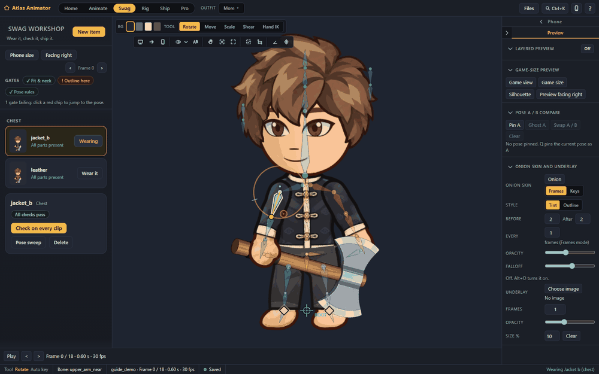

3. **Phone size** shows the character at the size a phone shows it (the status bar says the zoom); **Facing right** flips the preview facing. The Preview tab on the right adds **Game view**, **Game size**, **Silhouette** and the onion / compare controls.

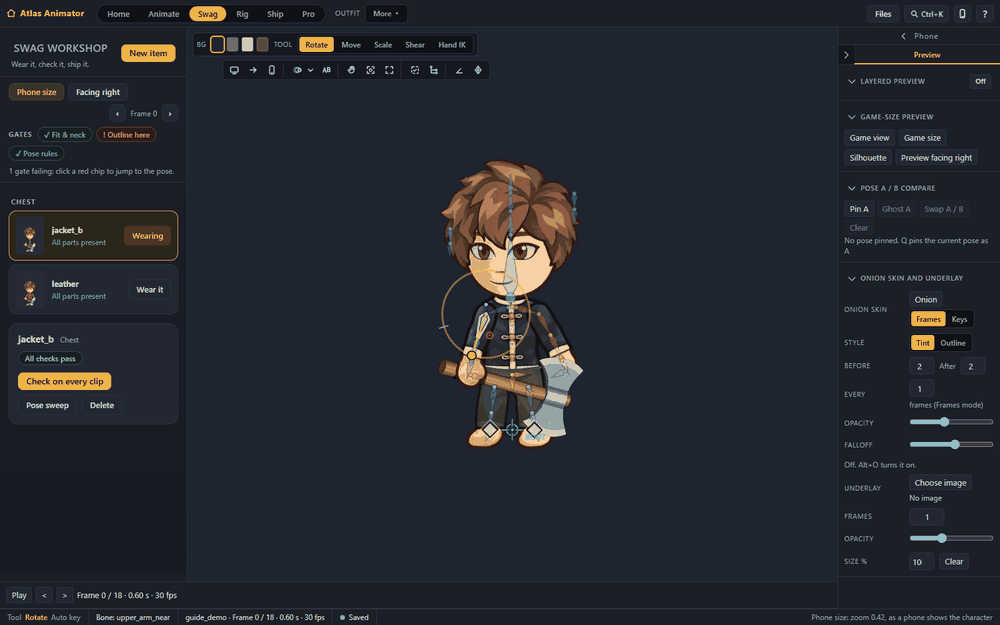

4. **Smear (weapon swing)** (Keys tab, in Animate) adds the weapon trail image used in attack clips.
5. Do not start garment work on a body view until that body template is approved.

### E. Ship (send to your project)

1. Open **Ship**. **Board-wide checks** shows how many clips are done, draft, missing, need a re-check or broken.
2. **Save** the open clip, then **Apply to rig** (tick **all rigs** to write to every view). This writes the clip into the rig file.
3. **Render sheets** makes contact sheets and phone-size previews in your `exports` folder; **Phone preview** (the phone icon in the header) shows the clip live on your phone over Wi-Fi.
4. **Export Spine** writes the rig as a Spine project into `exports\spine\<rig>\` (the status says the exact file, with **Copy path**; warnings such as "rotation limits have no Spine equivalent" are normal). It includes the clips that are applied to the rig, so press **Apply to rig** first. **Download clip JSON** gives you one clip file.
5. **Publish to project folder** copies one of your rigs or clips from your data folder into a project folder you choose. It is off until you start the editor with `ATLAS_EDITOR_PUBLISH_DIR=<absolute folder>` (or `pnpm dev -- --publish-dir <folder>`). Pick **Rig: <name>** or **Clip: <name>**, press **Check what changes** (it lists new and changed files and leaves files that only the project folder has alone), then **Publish**. The files it replaces are copied to `backups\published\` in your data folder first.
6. The result says exactly which files were written. Publish does **not** commit or push. Getting it into your game or app is still your step (commit, deploy). Published clips go to `packages\animator\clips\`, rigs to `packages\animator\rigs\<rig>\`.

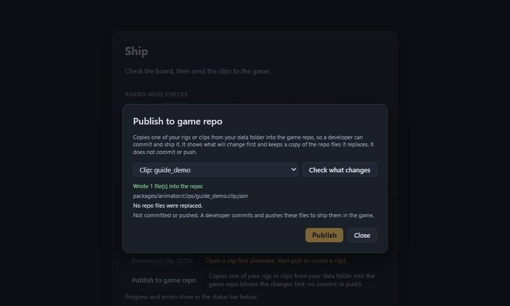

## 3. Where your files live

Your work lives in one folder **outside** the repository: `Documents/Atlas Animator/` in your home folder (on Windows `%USERPROFILE%\Documents\Atlas Animator\`). Deleting or cleaning a worktree, a git reset cannot touch it. Press **Files** in the header to see the exact folder, copy its path (**Copy path**), or change it. **Help** > **Open data folder path** copies the same path.
| What | Folder (inside the data folder) | Notes |
| --- | --- | --- |
| Clips | `clips\` | `<name>.clip.json` |
| Clip board, tween marks, references | `board.json`, `board-config.json`, `tween-marks.json`, `refs.json` | done marks, custom slots, Arc in-between marks, reference images |
| Versions | `history\` | the last 50 saved versions of every clip and rig (Versions… / Restore) |
| Autosave | `autosave\<clip>\` | newest 30 versions per clip, about 30 minutes (History panel) |
| Poses, smears | `poses\`, `smears\` | your pose library and weapon trails |
| Previews, Spine exports | `exports\` | safe to delete; regenerate any time |
| Your rigs | `rigs\<rig>\` | your working copies: every rig you made with New rig, and every sample rig you have edited |
| Backups | `backups\` | zips (section 4), plus `replaced-rigs\` and `published\` copies |
| Editor log | `logs\editor-<port>.log` | what the launcher started the editor with; send it with a bug report |

**Rigs: yours and the bundled sample ("stock") rigs.** The repository keeps the sample rigs in `packages/animator/rigs/`. The editor always opens **your** copy of a rig when you have one, and the stock rig otherwise. The first time you change a stock rig (Setup save, Apply, Skins, Import from Spine), the editor copies that rig's folder into your `rigs\` folder and from then on only changes your copy. Nothing you do in the editor writes outside your data folder except **Publish to project folder** (section 2E).

**When a developer updates a stock rig you also changed**, a yellow bar says *A newer stock version of the rig "<name>" exists*:
- **Compare** lists the stock files that changed and the bone / slot / skin / clip counts of yours against the stock one.
- **Take theirs** uses the stock version (it asks you to confirm). Your copy is moved to `backups\replaced-rigs\<rig>-<time>\` first (nothing is deleted). Reload the page afterwards.
- **Keep mine** keeps your copy. You are asked again only if the stock version changes again.
- **Later** hides the bar until the next reload. Your copy is never overwritten without one of these answers.

**Change the data folder:** Files -> **Data folder** -> type a full path -> **Use this folder** (or **Use default**). A new, empty folder gets a copy of your current files; the old folder is left as it is. The change takes effect after you close the editor and start it again. (Developers: `ATLAS_EDITOR_DATA_DIR=<folder>` overrides both, and the field is then read-only and says so.)

## 4. Back up and restore

**Automatic:** once a day, when something changed, the editor zips the whole data folder to `backups\auto-<time>.zip`. The newest 14 are kept.

**Back up now:** Files -> **Back up now** makes `backups\manual-<time>.zip` at any moment (these are never removed automatically); the dialog says how many files and where. For extra safety, copy the `backups` folder (or the whole data folder) to another drive now and then.
**Restore from backup…:** Files -> pick a backup in the list -> **Restore from backup…** -> OK. The editor first zips your current files to `backups\before-restore-<time>.zip`, then writes every file from the chosen backup back; files you made after that backup stay. Reload the page afterwards. The `pre-migration` zip can be restored the same way.

**Restore one clip by hand:** open the zip in Explorer and copy `clips\<clip>.clip.json` into the data folder's `clips\`, then reload the page.
**Restore an earlier save of a clip:** Clip board -> the clip's **...** menu (or right-click it) -> **Versions...** -> **Restore**.
**Restore a recent edit you did not save:** open the clip, **Library** tab, **History**, Preview a version, then Restore.
**Restore a rig:** Rig -> **Versions…** restores the rig document. For a whole rig folder, copy it from a backup zip (or from `backups\replaced-rigs\`) into the data folder's `rigs\`. Never restore only some files of a rig; the atlas pages and the document go together.
**After Import from Spine:** use **Revert import** immediately if the result is wrong.

## 5. Troubleshooting

### The editor will not open

1. Run the launcher (`tools\atlas-animator\Start Atlas Animator.cmd`) again. If the editor is already running it only opens the browser; if it is not, it starts it and says "Ready".
2. If the window closes with "Atlas Animator did not start", read the log: `<data folder>\logs\editor-5211.log`, normally `Documents\Atlas Animator\logs\editor-5211.log` in your home folder (paste it into the Windows address bar). **Help** > **About** shows the exact log path of a running editor.
3. Common messages: "Vite is missing ... Run 'pnpm install'" (ask a developer for one `pnpm install` in the checkout); "The editor stopped right after starting" or "did not start within 60 s" (the log says why).
4. **Port in use.** The editor uses port 5211. If the page does not load but something is already listening there, either it is the editor on another checkout (close that one: `powershell -File "tools\atlas-animator\start-atlas-animator.ps1" -Stop`), or another program holds the port: start the editor on a spare one with `Start Atlas Animator.cmd -Port 5300` and open `http://localhost:5300/`. Your files are the same on every port.

### "Not saved" errors

- A red toast "Save failed: the editor server is not answering. <clip> is NOT saved." means the editor process stopped. **Do not close the tab**: your edits are still in it. Run the launcher again, then press **Save** again once the server answers (do not reload first: a reload drops the edits that are only in the tab).
- "Not saved: <reason>" or "Save failed: <reason>" in the status bar: read the reason. Disk full or a locked file are the usual causes. Free space, then **Save** again. "Skins not saved", "Pose not saved" and "Smear not saved" work the same way.
- "changed on disk since the editor opened it" (rig): someone or something changed that rig file. Reload the page and redo the last Setup edit.
- Leaving the tab with unsaved work shows the browser's "Leave site?" prompt; answer Cancel and save.

### Two tabs: "This clip changed in another tab/window"

You saved a clip that another tab (or another script) saved after you opened it. Nothing was overwritten yet. Choose **Reload theirs** (drops your edits here), **Save mine as a copy** (keeps both; the safe default) or **Overwrite with mine** (the other version is kept under **Versions…**). Use one tab at a time to avoid this.

### Restoring a version or a backup

- One clip, an earlier save: Clip board -> the clip's **...** menu (or right-click it) -> **Versions...** -> **Restore**.
- A clip, unsaved edits: **Library** tab -> **History** -> **Preview** -> **Restore** (or the **Restore** bar at startup).
- A rig document: Rig -> **Versions…** -> **Restore** (the page reloads).
- Everything: Files -> **Restore from backup…**. Your current files are zipped first, so it can be undone.

### A yellow "newer stock version" bar

A newer version of a sample rig arrived (for example after a git pull) and you also changed it. **Compare** shows what changed, then choose **Take theirs** (stock rig; your copy goes to `backups\replaced-rigs\`) or **Keep mine** (the bar returns only if stock changes again). **Later** just hides it until the next reload.

### The rig looks broken after an update

1. If the yellow bar is showing, press **Compare**: it lists the stock files that changed and the bone, slot, skin and clip counts of both versions. If yours is the broken one, **Take theirs**; if the stock one is, **Keep mine**.
2. If you already pressed **Take theirs** and want your work back: Rig -> **Versions…** -> **Restore** an earlier version, or copy your folder from `backups\replaced-rigs\<rig>-<time>\` into `rigs\` (close the editor first).
3. Reload the page after any of these. If it is still broken, send a bug report (below).

### Where are my files?

Press **Files** (header) or **Help** > **Open data folder path**. Normally `Documents/Atlas Animator/` in your home folder (section 3). If your work looks older than you expect, check that Files shows the folder you expect: the data folder setting only takes effect after a restart, and `ATLAS_EDITOR_DATA_DIR` overrides it.

### Sending a bug report

1. When something fails, a red toast appears bottom right with **Copy details**. Press it and paste the text into your message.
2. **Help** > **About** > **Copy details** copies the version, commit hash, data folder and log path.
3. Attach the log file (`<data folder>\logs\editor-5211.log`) and say what you pressed last.
## 6. Rules of thumb

- Save before you close the tab (the browser warns you if there is unsaved work).
- One tab only. A second tab saving the same clip brings up the conflict dialog (section 5).
- Pose and smear delete are immediate and permanent.
- Your work is safe from git and checkout clean-ups, but not from a dead disk: copy `backups\` to another drive now and then.
- Publish only what you want in your project; you still commit it.
